# Use cases

Use cases derived from [context.md](context.md) and how each one would be implemented on the [hexagonal architecture](hexagonal-architecture.md). Diagrams are Mermaid (they render on GitHub and in VS Code).

- **Status**: Draft
- The first section (catalog and map) can be read without knowing the code. From "Implementation per use case" on it's technical.

## Actors

| Actor | Who they are |
|---|---|
| **Leader** | Whoever uses the tool: sets up the team, defines the goal and approves what the agents propose. |
| **Member** | Works on the board and on GitHub. |
| **AI agents** | Product analyst, agile coach, architect, product manager, product owner, scrum master, spec writer, code reviewer. |
| **GitHub** | External system: issues, PRs, reviews. Reports changes by webhook. |

## Catalog

| ID | Use case | Primary actor | Spec |
|---|---|---|---|
| UC-01 | Create project and team | Leader | 001 |
| UC-02 | Edit project and team | Leader | 001 |
| UC-03 | Generate the plan by stages | AI agents | 002 |
| UC-04 | Review a proposal (approve, adjust, reject or auto-approve) | Leader | 005 |
| UC-05 | Apply the approved plan to the board | System | 003 |
| UC-06 | Work on the board (move, edit, checklist) | Leader / Member | 003 |
| UC-07 | View roadmap, methodology and architecture | Leader / Member | 004 |
| UC-08 | Generate specs and diagrams | AI agents | 006 |
| UC-09 | Connect the GitHub repo | Leader | 007 |
| UC-10 | Publish tasks as issues | AI agents → Leader | 007 |
| UC-11 | Request a code review for a PR | AI agents → Leader | 007 |
| UC-12 | Sync progress from GitHub and close objectives | GitHub | 008 |
| UC-13 | Replan | Leader / AI agents | 008 |
| UC-14 | Follow the live activity | Leader / Member | 005 |

## Overview map

Each actor takes part in one area; how the use cases chain together is in the full journey below.

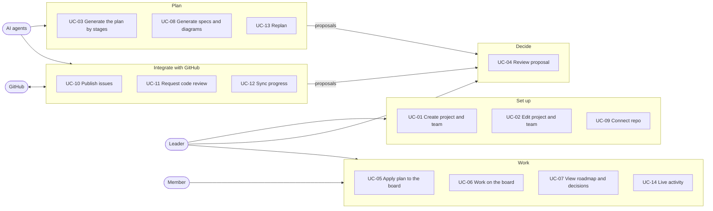

## Full journey

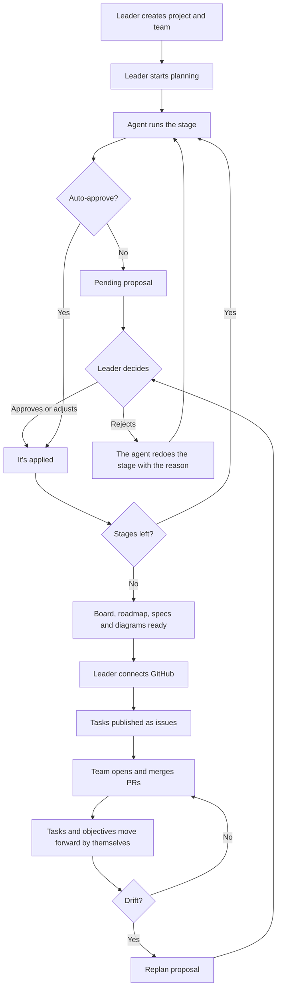

## States

### Proposal

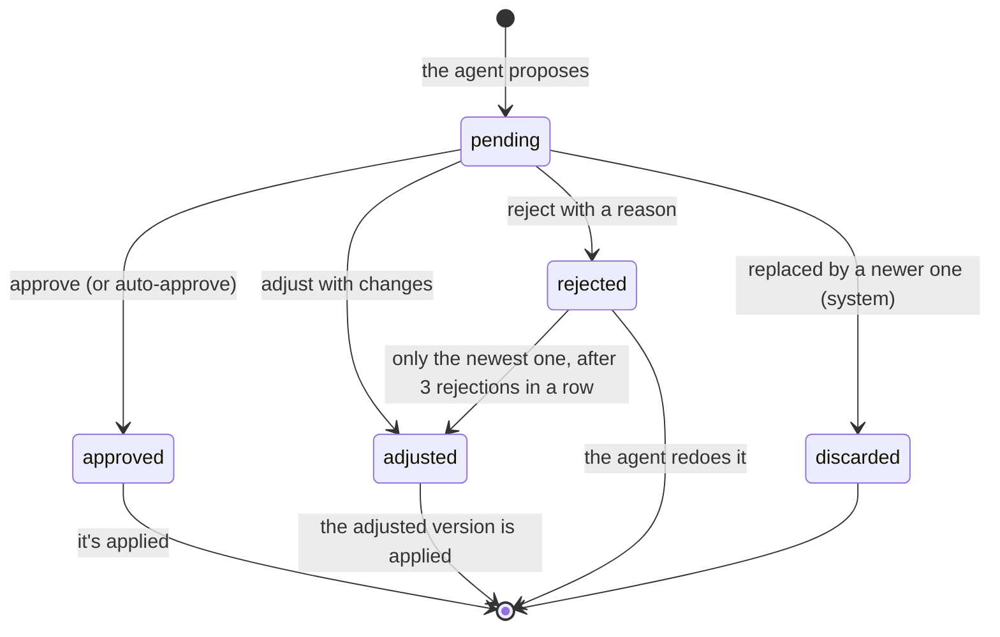

Applying is separate from the status: an approved or adjusted proposal whose application fails keeps its status, gets `apply_failed = true`, and can be retried (`POST /api/proposals/{id}/apply`, spec 005).

### Task

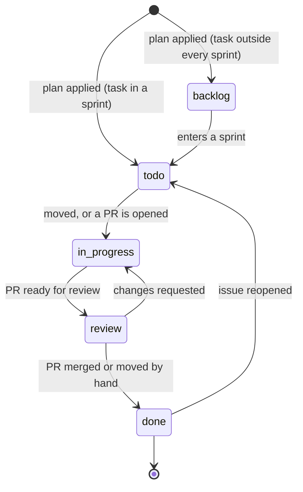

---

## Implementation per use case

Diagram conventions:

- **UI**: frontend (React), goes through the frontend's `adapters/http`.
- **HTTP** / **Webhook**: inbound adapters (`adapters/inbound`).
- The participant in the middle is the **use case** (`application/use_cases`).
- **UoW**, **Agents**, **CodeHost**, **EventBus**: ports. At runtime they're implemented by SQLModel, ADK or mock, GitHub or fake, and the in-memory bus.

Agent calls take time (seconds to minutes), so they **never run inside the HTTP request**: the endpoint answers `202 Accepted`, the use case runs in a background task and progress arrives through SSE (UC-14).

### UC-01 · Create project and team

- **Trigger**: the leader fills in the form (name, description, duration, optional methodology, auto-approve, members with role, seniority, hours and skills).
- **Result**: project in `draft` with its team. Planning starts with a separate request (spec 002), which the UI sends right after.
- **Use case**: `projects/create_project.py`

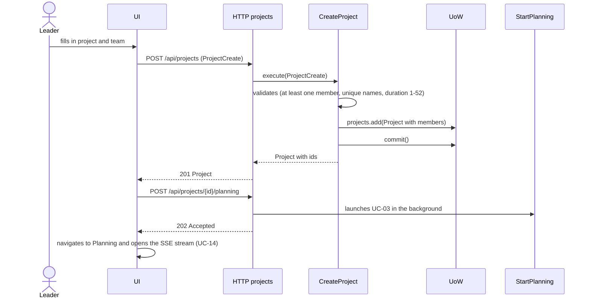

### UC-02 · Edit project and team

- **Trigger**: the leader changes project data, adds or removes members, or toggles auto-approve.
- **Result**: project updated. If the team changed, a `TeamChanged` event is published; with a plan already applied, spec 008 proposes a replan (UC-13).
- **Use case**: `projects/update_project.py`

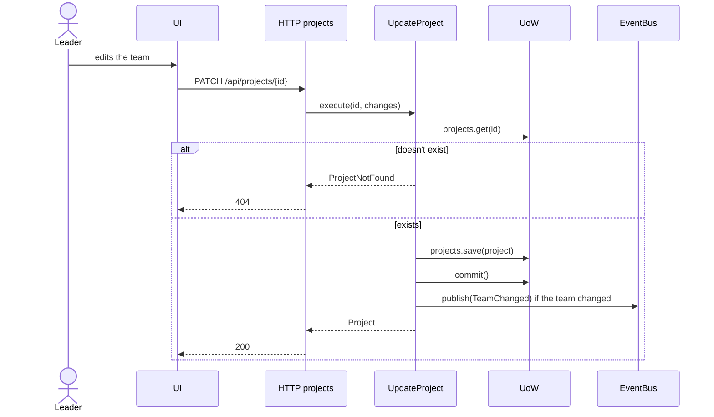

### UC-03 · Generate the plan by stages

- **Trigger**: the "start planning" request, or the approval of the previous stage (UC-04).
- **Result**: one `pending` proposal per stage (or `approved` with auto-approve).
- **Stages** (`PLANNING_STAGES`): analysis → methodology → architecture → roadmap → backlog → sprints. The document stages follow (UC-08).
- **Use cases**: `planning/start_planning.py`, `planning/run_planning_step.py`. They replace the current `RunPlanning`, which runs everything back to back.

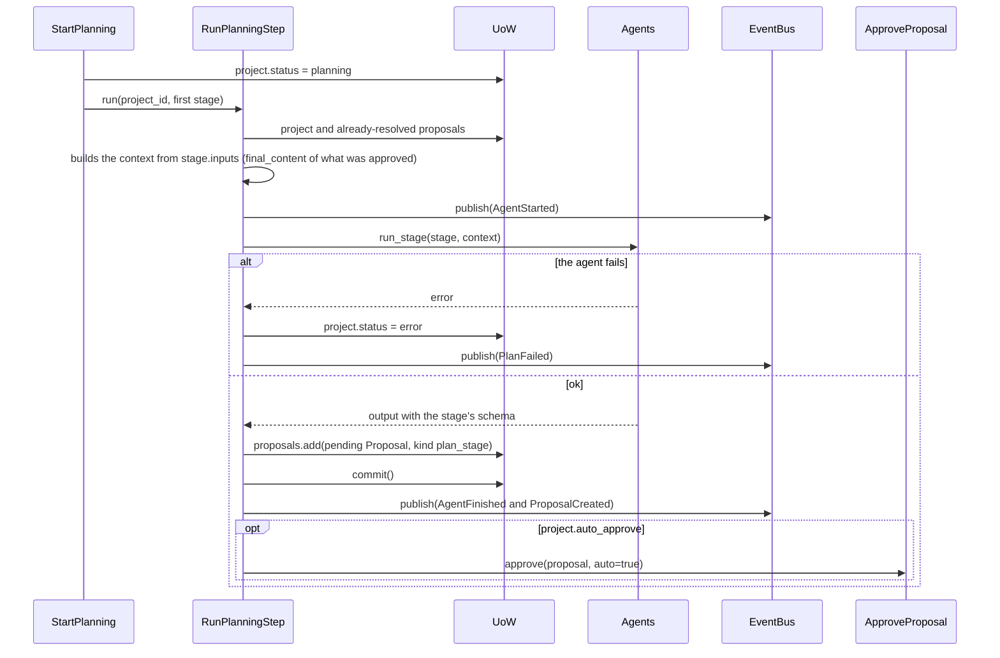

### UC-04 · Review a proposal

- **Trigger**: the leader opens a pending proposal (sees what the agent decided and why) and chooses.
- **Result**:
  - **Approve or adjust**: the decision is saved right away; then the step its owner spec registered applies `final_content` (see table) and, for plan stages, the next stage starts.
  - **Reject**: the reason (required) is saved and handed to the owner; for plan stages, spec 002 redoes the stage with the reason as context. After 3 rejections in a row of the same stage, it waits for the leader, who can adjust the newest rejected proposal with their own version.
- **Use cases**: `proposals/resolve_proposal.py` (`ApproveProposal`, `AdjustProposal`, `RejectProposal`), `proposals/apply_proposal.py` (`ApplyProposal`, `ApplierRegistry`, `RetryApply`), `proposals/auto_approve.py`, `proposals/approve_many.py`

| Proposal kind | What applying it does | Registered step |
|---|---|---|
| `plan_stage` | Saves the stage in `project.plan` and launches the next one; after `sprints`, triggers UC-05. On rejection, redoes the stage | `AdvancePlanning.on_proposal_resolved` (002) |
| `document` | Creates or versions a `Document` (UC-08) | `ApplyDocumentProposal` (006) |
| `github_action` | Runs the action on `CodeHost` (UC-10, UC-11) | `PublishIssues` / `ApplyReview` (007) |
| `replan` | Applies the changes to the board (UC-13) | `ApplyReplan` (008) |

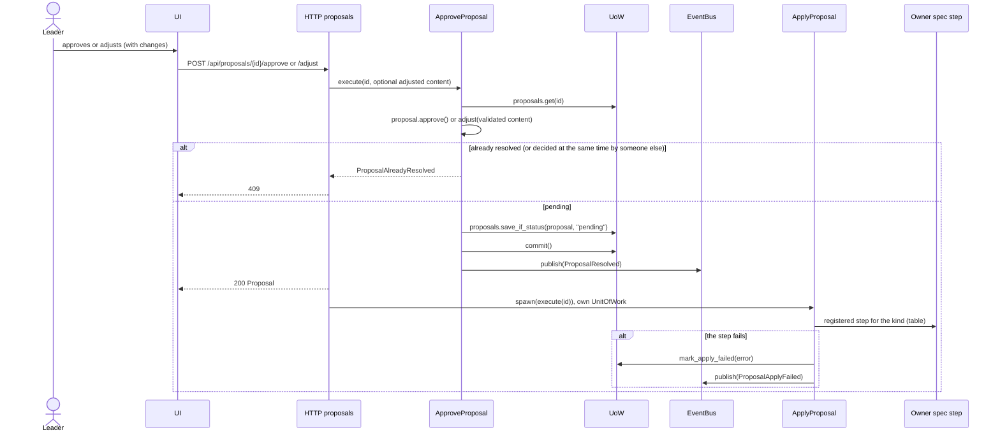

With **auto-approve**, the creator calls `AutoApprove.after_created(proposal_id)` after saving the proposal: it's approved with `auto_approved = true` and applied the same way, unless its `origin` is `automatic` (spec 008 drift replans always wait for the leader).

### UC-05 · Apply the approved plan to the board

- **Trigger**: the `sprints` stage is approved.
- **Result**: `Sprint`, `Objective` and `Task` created, with priority, points, acceptance criteria, checklist and assignee; the project moves to `ready`.
- **Assignment**: by the agent's exact `member_name`; otherwise, the member with the requested `role` and the fewest points in that sprint; if nobody has the role, unassigned and flagged with the missing role (spec 003, FR-006).
- **Checklist**: comes from each story's acceptance criteria.
- **Use case**: `planning/apply_plan.py` (pure building logic in `domain/board.py`)

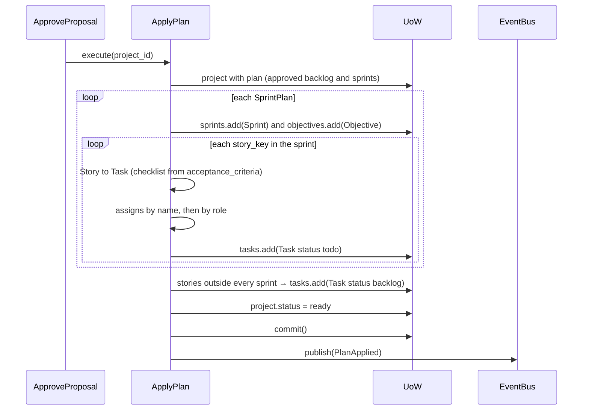

### UC-06 · Work on the board

- **Trigger**: someone drags a card (dnd-kit), edits a task or checks a checklist item.
- **Result**: task updated. If the methodology's WIP limit is exceeded, a warning is shown but nothing is blocked ("The user is in charge").
- **Use cases**: `board/move_task.py`, `board/update_task.py`, `board/toggle_checklist_item.py`

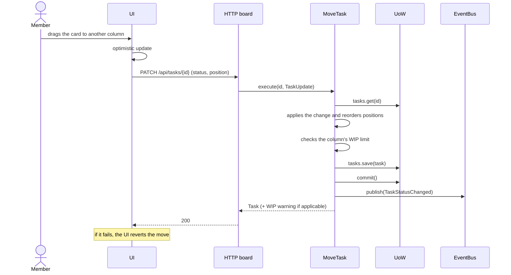

### UC-07 · View roadmap, methodology and architecture

- **Trigger**: the leader or a member opens the plan views.
- **Result**: visual roadmap by phases and weeks with each epic's and phase's progress, methodology with ceremonies and discarded alternatives, and architecture with its decisions. Each view says its status (not generated, waiting for approval, approved) and, when approved, the agent, its rationale and how it was approved.
- **Use case**: `projects/get_plan_views.py` (read-only). The views are built by the pure `domain/plan_views.build_plan_views`; the roadmap is drawn in the frontend from `RoadmapView.phases`.

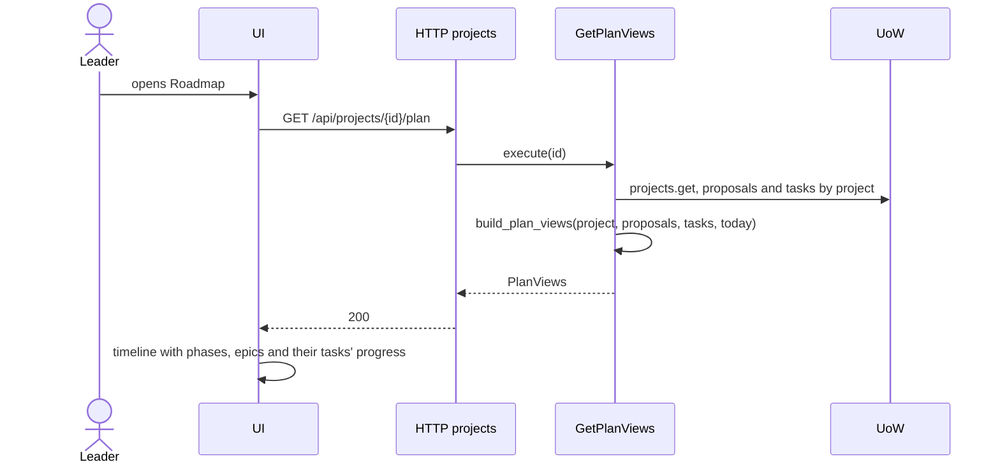

### UC-08 · Generate specs and diagrams

- **Trigger**: the plan finishes being approved (after `sprints`), or the leader asks to regenerate a document.
- **Result**: proposals of kind `document`: general spec, one spec per roadmap epic, and flow diagrams in Mermaid. Once approved they become versioned `Document`s.
- **New stages** in `PLANNING_STAGES`: `general_spec`, `epic_specs`, `flow_diagrams`, each with its output schema.
- **Use case**: `planning/generate_documents.py`, which reuses `RunPlanningStep`.

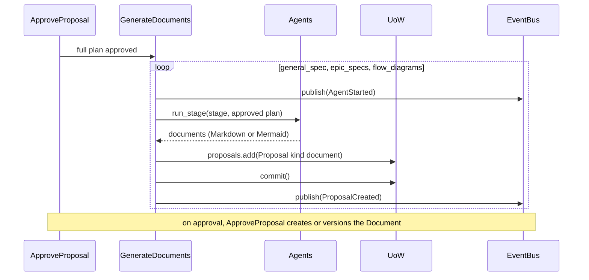

### UC-09 · Connect the GitHub repo

- **Trigger**: the leader types `owner/name` in Integrations.
- **Result**: `project.repository` saved and webhook registered on the repo. One repo per project: if there was one already, it's replaced.
- **Use case**: `integrations/connect_repository.py`
- **Port**: `CodeHost` needs `check_access(repository)` and `register_webhook(repository, url, secret)`.

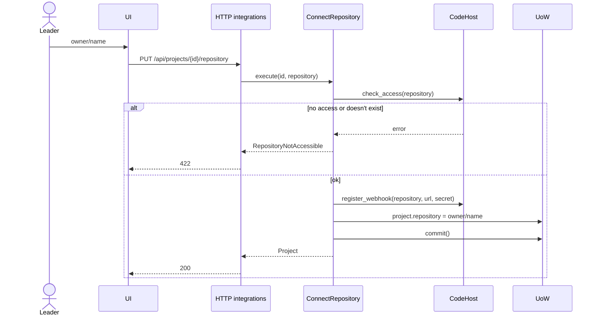

### UC-10 · Publish tasks as issues

- **Trigger**: the first time the project has both a board (UC-05) and a repo, when a replan that adds tasks is approved, or when the leader asks for it (spec 007, FR-006).
- **Result**: a `github_action` proposal with the list of issues to create. When approved, each issue is created (title, description, criteria and checklist as a GitHub task list, type and priority labels) and a task ↔ issue `ExternalLink` is saved.
- **Use cases**: `integrations/propose_issues.py` and the `github_action` branch of `ApproveProposal`.

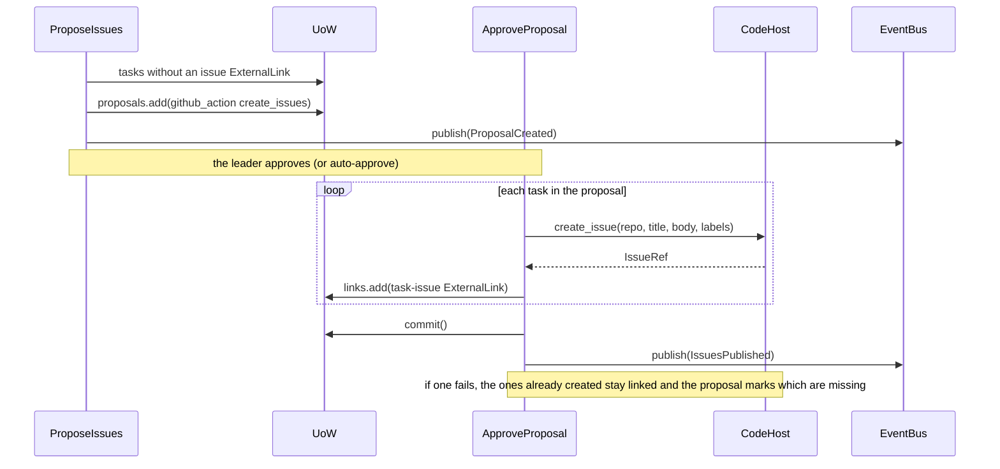

### UC-11 · Request a code review for a PR

- **Trigger**: a webhook arrives for an opened PR that references a project issue (`Closes #12`).
- **Result**: a `github_action` proposal with the suggested reviewers (members with the right role and the lowest load) and a review comment written by the reviewer agent. When approved, the reviews are requested and the comment is posted.
- **Use case**: `integrations/propose_review.py`
- **Port**: `CodeHost` needs `get_pull_request_diff` and `comment_on_pull_request`. Members need their GitHub username (`Member.github_username`).

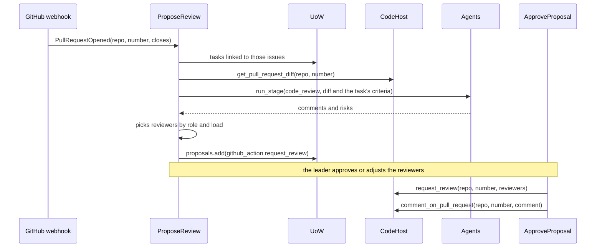

### UC-12 · Sync progress from GitHub and close objectives

- **Trigger**: GitHub webhooks (`pull_request`, `issues`).
- **Result**: the board reflects real progress. Since **our board is the source of truth**, only state changes come in from GitHub and they're applied without a proposal.

| GitHub event | Effect on the task |
|---|---|
| PR opened that closes the issue | `in_progress` |
| PR ready for review | `review` |
| PR merged | `done` and checklist complete |
| Issue closed as completed, without a PR | `done` |
| Issue closed as not planned | No change; shown in the activity feed |
| Issue reopened | `todo` |

- GitHub events never move a task out of `done`, except reopening the issue. Events caused by the system's own writes are ignored (spec 008, FR-015).
- When all the tasks of an objective are `done`, the `Objective` closes.
- **Use cases**: `integrations/handle_pull_request_event.py`, `handle_issue_event.py`

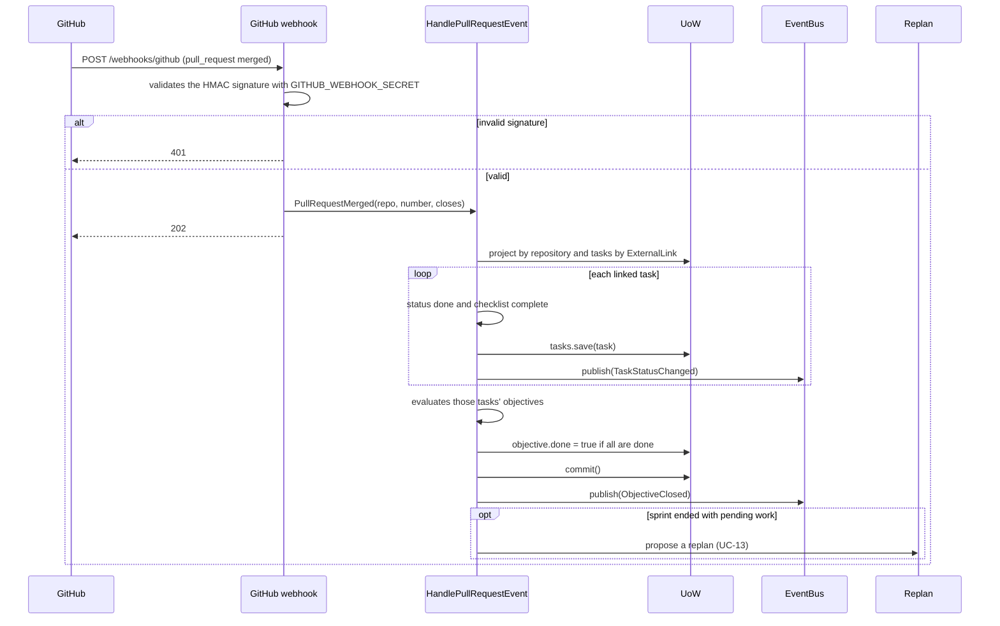

### UC-13 · Replan

- **Trigger**:
  - the leader asks for it with a reason ("a dev left", "a new client came in"),
  - the team changed (UC-02),
  - a sprint ended with pending work (UC-12).
- **Result**: a `replan` proposal with a diff over the current board (tasks that move between sprints, reassignments, new or discarded tasks) and its rationale. When approved, the diff is applied; `done` tasks are never touched. Automatic replans always wait for the leader, even with auto-approve (spec 008, FR-016).
- **Use case**: `planning/replan.py` (new `replan` stage with its diff schema).

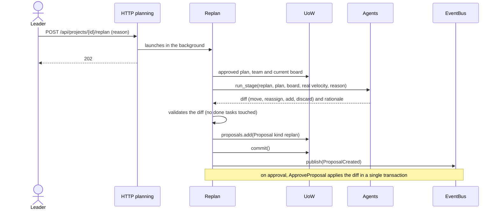

### UC-14 · Follow the live activity

- **Trigger**: any project screen is open.
- **Result**: the UI sees live which agent is working, the new proposals and the board changes, without reloading ("Agent transparency"). Every event is also kept as the project's history.
- **Adapter**: `inbound/http/activity.py` exposes `GET /api/projects/{id}/events` as SSE (`sse-starlette`) and `GET /api/projects/{id}/activity` for the history. `PersistentEventBus` saves every event (its row id is the event's `seq`) before fanning it out; `FollowActivity` replays what a reconnecting client missed.

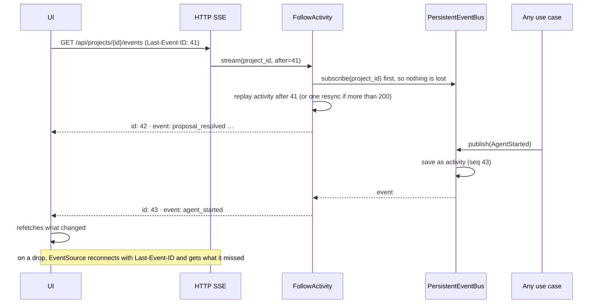

---

## Impact on the architecture

What these use cases add to what's already on `main`:

| Where | What's missing |
|---|---|
| `domain/plan.py` | Stages `general_spec`, `epic_specs`, `flow_diagrams`, `code_review`, `replan`, with their schemas |
| `domain/proposals.py` | `rejection_reason` in `Proposal` |
| `domain/project.py` | `Member.github_username`; `Objective` linked to a sprint and its tasks |
| `domain/events.py` | `TeamChanged`, `PlanApplied`, `IssuesPublished`, `ObjectiveClosed` |
| `application/ports/code_host.py` | `check_access`, `register_webhook`, `update_issue`, `get_pull_request_diff`, `comment_on_pull_request` |
| `application/ports/repositories.py` | `ExternalLinkRepository`, `ObjectiveRepository`; add `proposals`, `documents`, `links` and `objectives` to the `UnitOfWork` |
| `application/use_cases/planning/` | `RunPlanning` (back to back) is replaced by `StartPlanning` + `RunPlanningStep` |
| Background execution | Agents run in `asyncio.create_task` from the HTTP adapter; that task has its own DB session, not the request's |

## Open questions

1. ~~**UC-11**: does the system also open PRs?~~ **Resolved in spec 007**: no, it only requests reviews and comments. The team opens the PRs.
2. ~~**UC-04 reject**: does the agent redo the stage automatically with the reason, or does the leader decide when?~~ **Resolved**: it redoes it automatically with the reason; after 3 rejections in a row of the same stage it waits for the leader ([spec 002](../specs/002-agent-planning-pipeline/spec.md), FR-011).
3. ~~**UC-12**: does drift detection (sprint ended with pending work) propose a replan by itself, or just warn?~~ **Resolved**: it proposes the replan by itself, also on team changes, and it always waits for the leader's decision, even with auto-approve ([spec 008](../specs/008-github-sync-replanning/spec.md), FR-010 and FR-016).
