# Casos de uso

Casos de uso que salen de [context.md](context.md) y cómo se implementaría cada uno sobre la [arquitectura hexagonal](hexagonal-architecture.md). Los diagramas son Mermaid (se ven en GitHub y en VS Code).

- **Estado**: Borrador
- La primera sección (catálogo y mapa) se lee sin saber de código. De "Implementación por caso de uso" en adelante es técnico.

## Actores

| Actor | Quién es |
|---|---|
| **Líder** | Quien usa la herramienta: arma el equipo, define la meta y aprueba lo que proponen los agentes. |
| **Miembro** | Trabaja sobre el tablero y en GitHub. |
| **Agentes IA** | Analista, agile coach, arquitecto, product manager, product owner, scrum master, redactor de specs, revisor de código. |
| **GitHub** | Sistema externo: issues, PRs, reviews. Avisa cambios por webhook. |

## Catálogo

| ID | Caso de uso | Actor principal | Spec |
|---|---|---|---|
| UC-01 | Crear proyecto y equipo | Líder | 001 |
| UC-02 | Editar proyecto y equipo | Líder | 001 |
| UC-03 | Generar el plan por etapas | Agentes IA | 002 |
| UC-04 | Revisar una propuesta (aprobar, ajustar, rechazar o auto-aprobar) | Líder | 005 |
| UC-05 | Aplicar el plan aprobado al tablero | Sistema | 003 |
| UC-06 | Trabajar en el tablero (mover, editar, checklist) | Líder / Miembro | 003 |
| UC-07 | Ver roadmap, metodología y arquitectura | Líder / Miembro | 004 |
| UC-08 | Generar specs y diagramas | Agentes IA | 006 |
| UC-09 | Conectar el repo de GitHub | Líder | 007 |
| UC-10 | Publicar tareas como issues | Agentes IA → Líder | 007 |
| UC-11 | Pedir code review de un PR | Agentes IA → Líder | 007 |
| UC-12 | Sincronizar el avance desde GitHub y cerrar objetivos | GitHub | 008 |
| UC-13 | Re-planificar | Líder / Agentes IA | 008 |
| UC-14 | Seguir la actividad en vivo | Líder / Miembro | 005 |

## Mapa general

Cada actor participa en un área; cómo se encadenan los casos de uso está en el recorrido completo, más abajo.

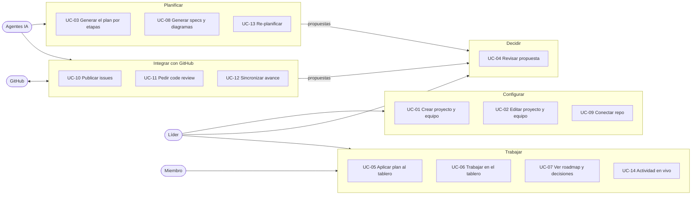

## Recorrido completo

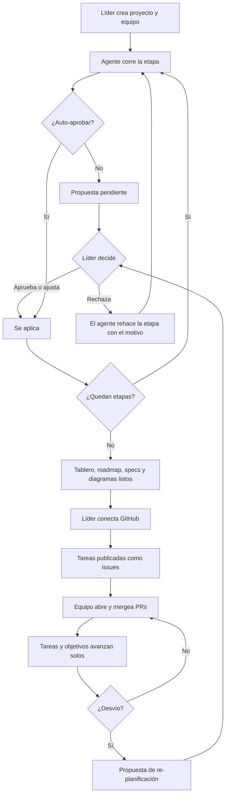

## Estados

### Propuesta

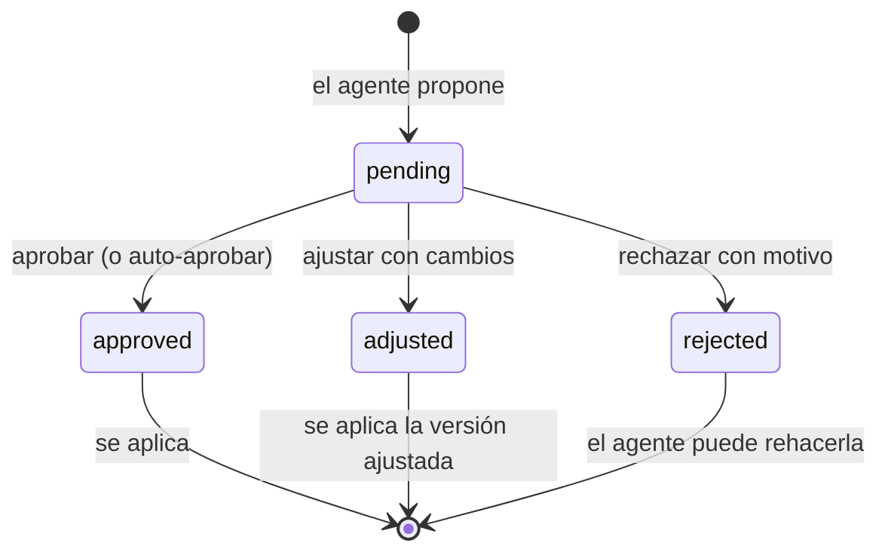

### Tarea

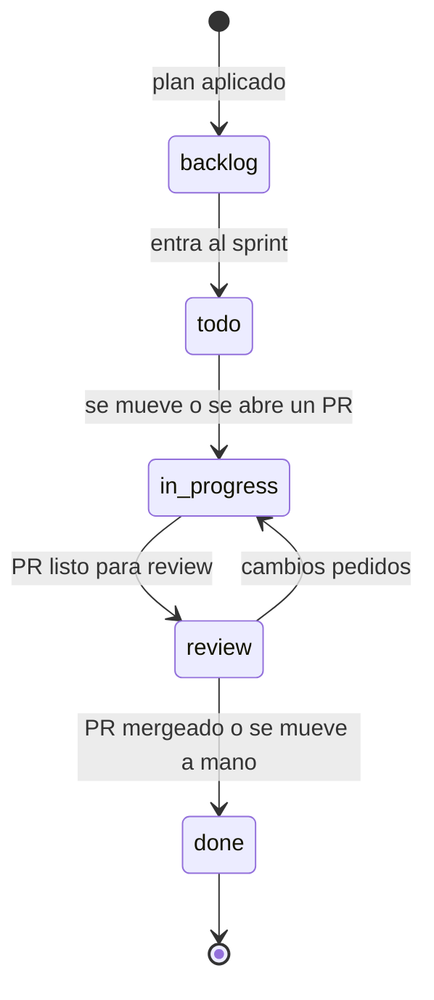

---

## Implementación por caso de uso

Convenciones de los diagramas:

- **UI**: front (React), pasa por `adapters/http` del front.
- **HTTP** / **Webhook**: adaptadores de entrada (`adapters/inbound`).
- El participante del medio es el **caso de uso** (`application/use_cases`).
- **UoW**, **Agents**, **CodeHost**, **EventBus**: puertos. En runtime los implementan SQLModel, ADK o mock, GitHub o fake, y el bus en memoria.

Las llamadas a los agentes tardan (segundos a minutos), así que **nunca se hacen dentro del request HTTP**: el endpoint responde `202 Accepted`, el caso de uso corre en una tarea de fondo y el progreso llega por SSE (UC-14).

### UC-01 · Crear proyecto y equipo

- **Disparador**: el líder completa el formulario (nombre, descripción, duración, metodología opcional, auto-aprobar, miembros con rol, seniority, horas y skills).
- **Resultado**: proyecto en `draft` con su equipo; arranca UC-03.
- **Caso de uso**: `projects/create_project.py`

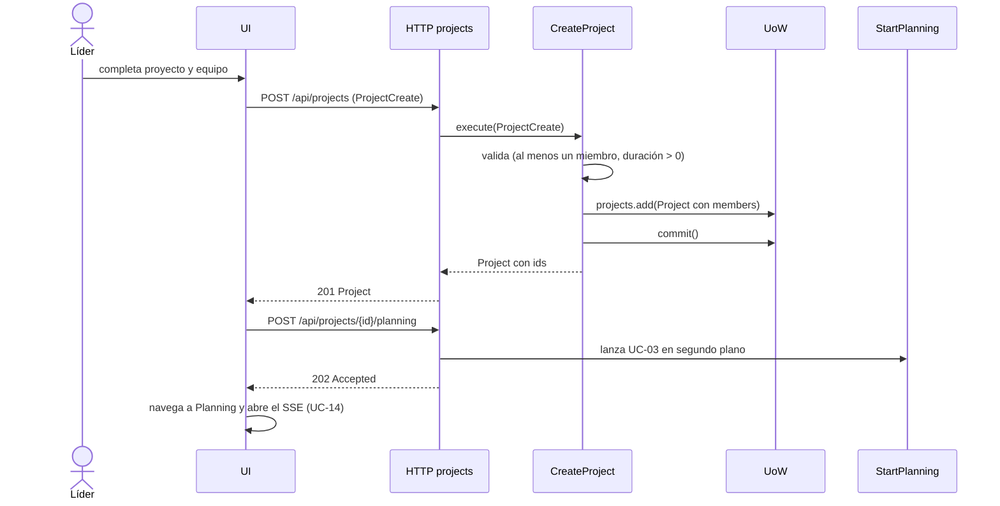

### UC-02 · Editar proyecto y equipo

- **Disparador**: el líder cambia datos del proyecto, agrega o quita miembros, o cambia auto-aprobar.
- **Resultado**: proyecto actualizado. Si cambia el equipo con un plan ya aplicado, se ofrece re-planificar (UC-13).
- **Caso de uso**: `projects/update_team.py`

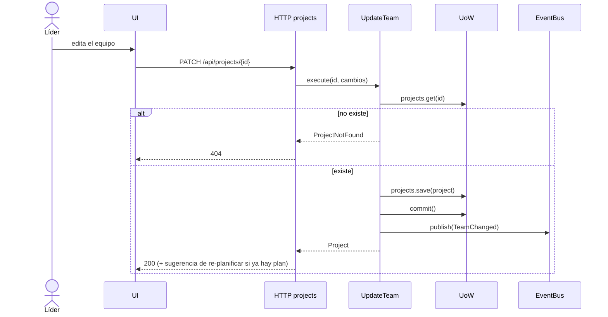

### UC-03 · Generar el plan por etapas

- **Disparador**: UC-01, o la aprobación de la etapa anterior (UC-04).
- **Resultado**: una propuesta `pending` por etapa (o `approved` con auto-aprobar).
- **Etapas** (`PLANNING_STAGES`): analysis → methodology → architecture → roadmap → backlog → sprints. Después siguen las de documentos (UC-08).
- **Casos de uso**: `planning/start_planning.py`, `planning/run_planning_step.py`. Reemplazan al `RunPlanning` actual, que corre todo de corrido.

### UC-04 · Revisar una propuesta

- **Disparador**: el líder abre una propuesta pendiente (ve qué decidió el agente y por qué) y elige.
- **Resultado**:
  - **Aprobar o ajustar**: se aplica `final_content` según el tipo de propuesta (ver tabla) y sigue la etapa siguiente.
  - **Rechazar**: se guarda el motivo y el agente rehace la etapa automáticamente con ese motivo como contexto. Tras 3 rechazos seguidos de la misma etapa, espera al líder.
- **Casos de uso**: `proposals/approve_proposal.py`, `adjust_proposal.py`, `reject_proposal.py`

| Tipo de propuesta | Qué hace aprobarla |
|---|---|
| `plan_stage` | Guarda la etapa en `project.plan`. Si es `sprints`, dispara UC-05. Lanza la etapa siguiente. |
| `document` | Crea o versiona un `Document` (UC-08). |
| `github_action` | Ejecuta la acción en `CodeHost` (UC-10, UC-11). |
| `replan` | Aplica los cambios al tablero (UC-13). |

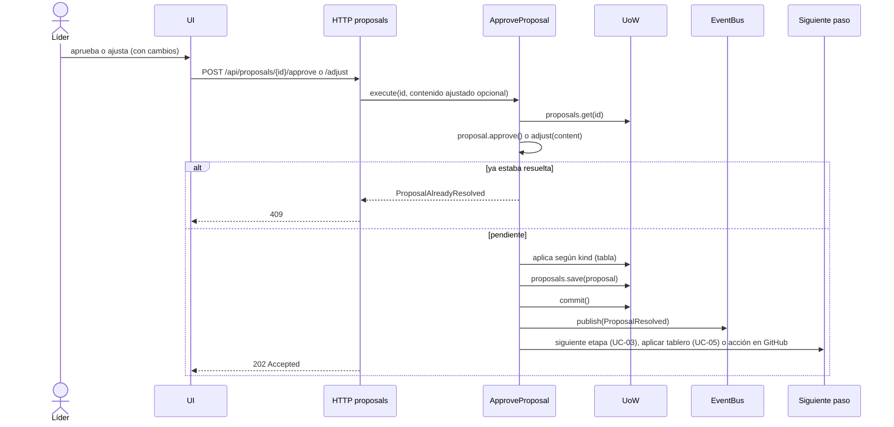

Con **auto-aprobar** el flujo es el mismo, pero lo llama `RunPlanningStep` con `auto=true` en lugar de la UI. La propuesta queda registrada con `auto_approved = true`.

### UC-05 · Aplicar el plan aprobado al tablero

- **Disparador**: se aprueba la etapa `sprints`.
- **Resultado**: `Sprint` y `Task` creados, con prioridad, puntos, criterios de aceptación, checklist y asignado; el proyecto pasa a `ready`.
- **Asignación**: por `member_name` exacto del agente; si no coincide, cae al primer miembro con el mismo `role` (como hace hoy el mock).
- **Checklist**: sale de los criterios de aceptación de cada historia. Más adelante el agente puede generar pasos propios.
- **Caso de uso**: `planning/apply_plan.py` (lógica pura de armado en `domain/board.py`)

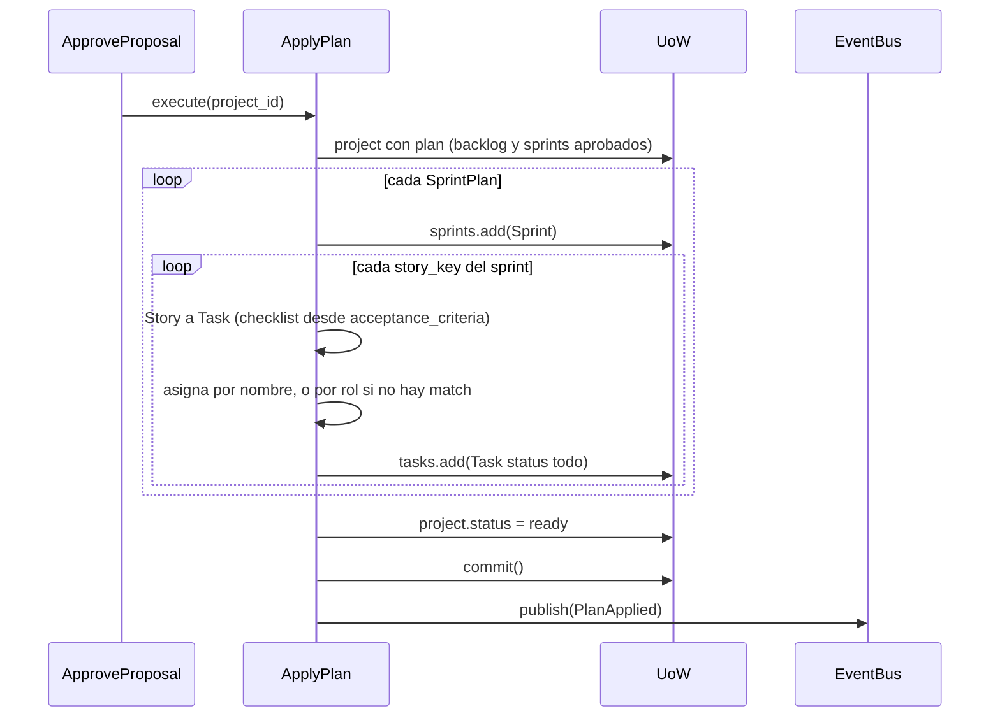

### UC-06 · Trabajar en el tablero

- **Disparador**: alguien arrastra una tarjeta (dnd-kit), edita una tarea o tilda un ítem del checklist.
- **Resultado**: tarea actualizada. Si se pasa el límite WIP de la metodología, se avisa pero no se bloquea ("El usuario manda").
- **Casos de uso**: `board/move_task.py`, `board/update_task.py`, `board/toggle_checklist_item.py`

### UC-07 · Ver roadmap, metodología y arquitectura

- **Disparador**: el líder o un miembro abre las vistas del plan.
- **Resultado**: roadmap gráfico por fases y semanas, metodología con ceremonias y alternativas descartadas, y arquitectura con ADRs. Cada vista muestra la justificación del agente.
- **Caso de uso**: `projects/get_project.py` (solo lectura). El roadmap se dibuja en el front a partir de `Roadmap.phases`.

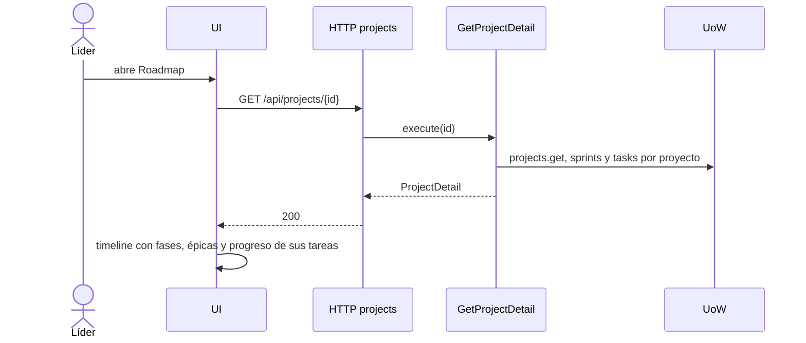

### UC-08 · Generar specs y diagramas

- **Disparador**: termina de aprobarse el plan (después de `sprints`), o el líder pide regenerar un documento.
- **Resultado**: propuestas de tipo `document`: spec general, una spec por épica del roadmap, y diagramas de flujo en Mermaid. Al aprobarse se convierten en `Document` versionados.
- **Etapas nuevas** en `PLANNING_STAGES`: `general_spec`, `epic_specs`, `flow_diagrams`, cada una con su esquema de salida.
- **Caso de uso**: `planning/generate_documents.py`, que reutiliza `RunPlanningStep`.

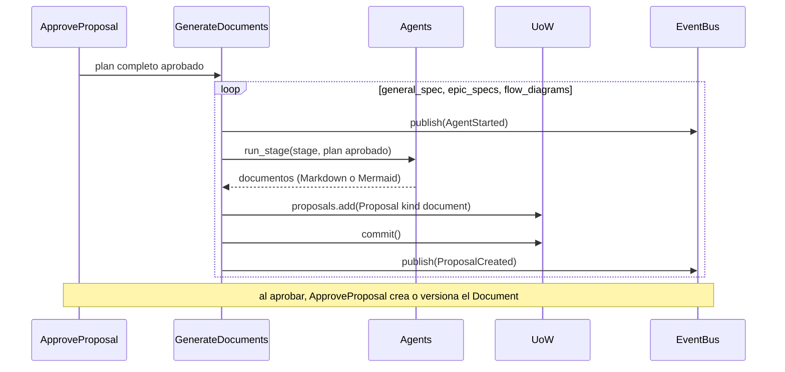

### UC-09 · Conectar el repo de GitHub

- **Disparador**: el líder escribe `owner/name` en Integraciones.
- **Resultado**: `project.repository` guardado y webhook registrado en el repo. Un solo repo por proyecto: si ya había uno, se reemplaza.
- **Caso de uso**: `integrations/connect_repository.py`
- **Puerto**: `CodeHost` necesita `check_access(repository)` y `register_webhook(repository, url, secret)`.

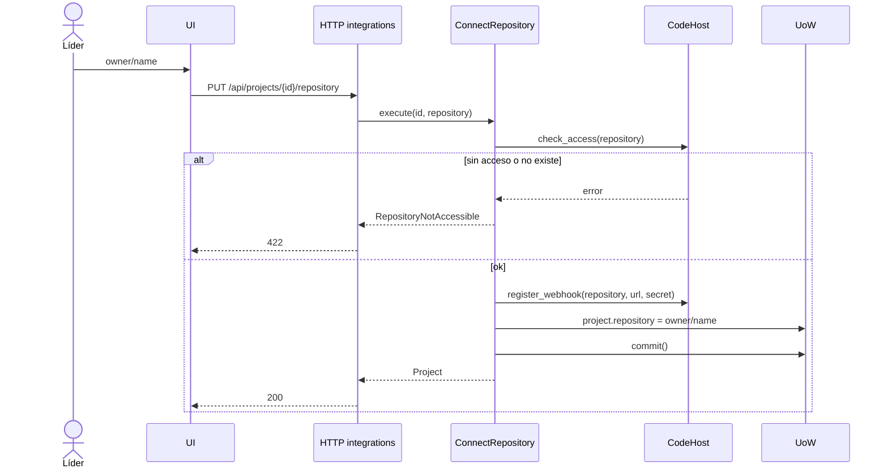

### UC-10 · Publicar tareas como issues

- **Disparador**: el plan está aplicado (UC-05) y el proyecto tiene repo, o el líder lo pide para tareas nuevas.
- **Resultado**: una propuesta `github_action` con la lista de issues a crear. Al aprobarla, se crea cada issue (título, descripción, criterios y checklist como task list de GitHub, labels de tipo y prioridad) y se guarda un `ExternalLink` tarea ↔ issue.
- **Casos de uso**: `integrations/propose_issues.py` y la rama `github_action` de `ApproveProposal`.

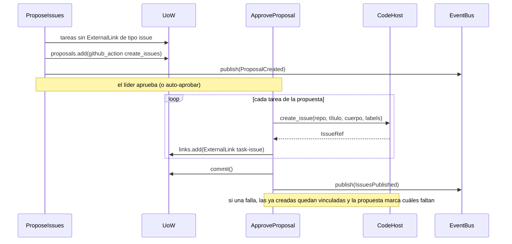

### UC-11 · Pedir code review de un PR

- **Disparador**: llega el webhook de un PR abierto que referencia una issue del proyecto (`Closes #12`).
- **Resultado**: propuesta `github_action` con los revisores sugeridos (miembros con el rol adecuado y menos carga) y un comentario de revisión hecho por el agente revisor. Al aprobarla se piden las reviews y se publica el comentario.
- **Caso de uso**: `integrations/propose_review.py`
- **Puerto**: `CodeHost` necesita `get_pull_request_diff` y `comment_on_pull_request`. Los miembros necesitan su usuario de GitHub (`Member.github_username`).

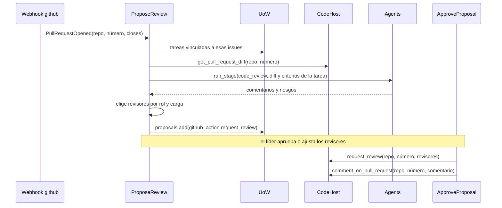

### UC-12 · Sincronizar el avance desde GitHub y cerrar objetivos

- **Disparador**: webhooks de GitHub (`pull_request`, `issues`).
- **Resultado**: el tablero refleja el avance real. Como **nuestro tablero es la fuente de verdad**, desde GitHub solo entran cambios de estado y se aplican sin propuesta.

| Evento de GitHub | Efecto en la tarea |
|---|---|
| PR abierto que cierra la issue | `in_progress` |
| PR listo para review | `review` |
| PR mergeado | `done` y checklist completo |
| Issue cerrada sin PR | `done` |
| Issue reabierta | `todo` |

- Cuando todas las tareas de un objetivo están `done`, el `Objective` se cierra.
- **Casos de uso**: `integrations/handle_pull_request_event.py`, `handle_issue_event.py`

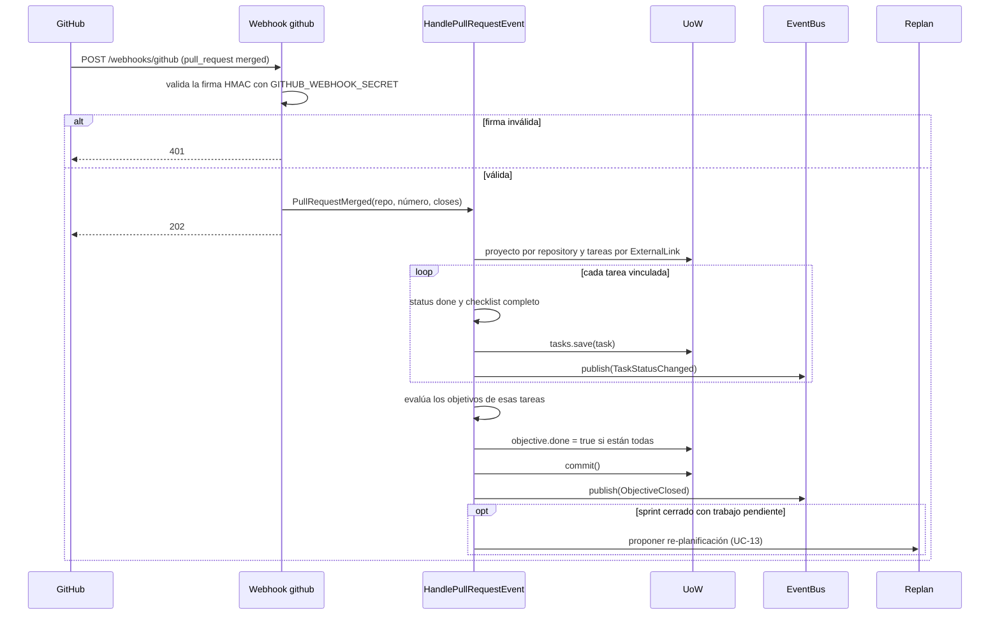

### UC-13 · Re-planificar

- **Disparador**:
  - el líder lo pide con un motivo ("se fue un dev", "entra un cliente nuevo"),
  - cambió el equipo (UC-02),
  - un sprint cerró con trabajo pendiente (UC-12).
- **Resultado**: propuesta `replan` con un diff sobre el tablero actual (tareas que se mueven de sprint, reasignaciones, tareas nuevas o descartadas) y su justificación. Al aprobarla se aplica el diff; las tareas `done` no se tocan.
- **Caso de uso**: `planning/replan.py` (nueva etapa `replan` con su esquema de diff).

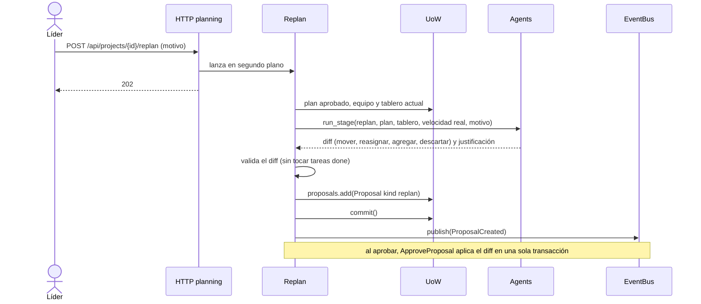

### UC-14 · Seguir la actividad en vivo

- **Disparador**: cualquier pantalla del proyecto abierta.
- **Resultado**: la UI ve en vivo qué agente está trabajando, las propuestas nuevas y los cambios del tablero, sin recargar ("Transparencia de agentes").
- **Adaptador**: `inbound/http/planning.py` expone `GET /api/projects/{id}/events` como SSE (`sse-starlette`) y se suscribe al `EventBus`.

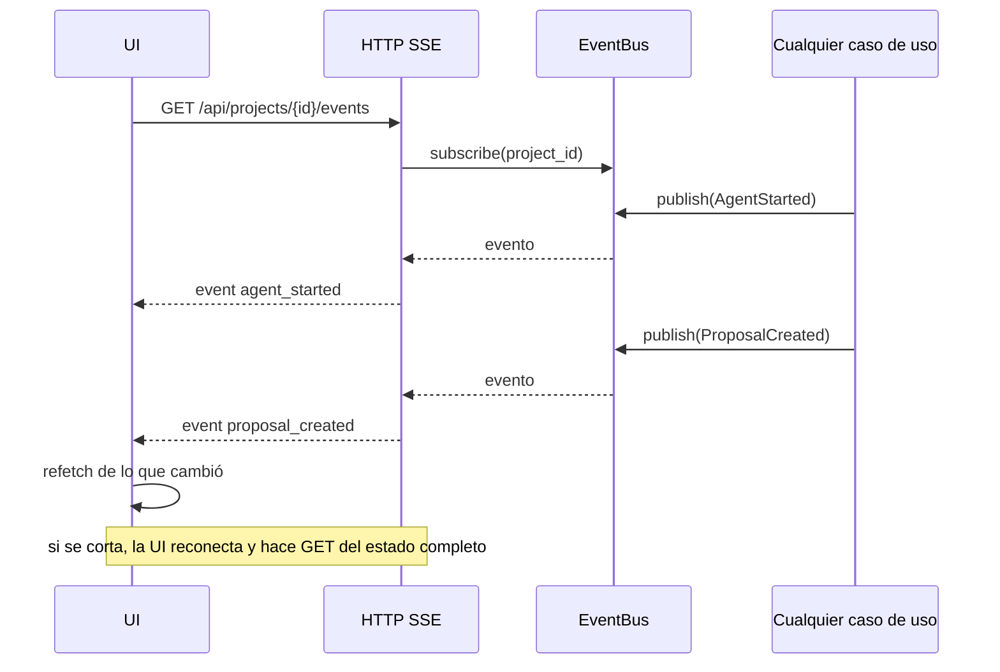

---

## Impacto en la arquitectura

Lo que estos casos de uso agregan a lo que ya está en `main`:

| Dónde | Qué falta |
|---|---|
| `domain/plan.py` | Etapas `general_spec`, `epic_specs`, `flow_diagrams`, `code_review`, `replan`, con sus esquemas |
| `domain/proposals.py` | `rejection_reason` en `Proposal` |
| `domain/project.py` | `Member.github_username`; `Objective` vinculado a fase y tareas |
| `domain/events.py` | `TeamChanged`, `PlanApplied`, `IssuesPublished`, `ObjectiveClosed` |
| `application/ports/code_host.py` | `check_access`, `register_webhook`, `get_pull_request_diff`, `comment_on_pull_request` |
| `application/ports/repositories.py` | `ExternalLinkRepository`, `ObjectiveRepository`; sumar `proposals`, `documents`, `links` y `objectives` al `UnitOfWork` |
| `application/use_cases/planning/` | `RunPlanning` (de corrido) se reemplaza por `StartPlanning` + `RunPlanningStep` |
| Ejecución en segundo plano | Los agentes corren en `asyncio.create_task` desde el adaptador HTTP; la sesión de DB de esa tarea es propia, no la del request |

## Preguntas abiertas

1. ~~**UC-11**: ¿el sistema también abre PRs?~~ **Resuelta en la spec 007**: no, solo pide reviews y comenta. Los PRs los abre el equipo.
2. ~~**UC-04 rechazar**: ¿el agente rehace la etapa automáticamente con el motivo, o el líder decide cuándo?~~ **Resuelta**: la rehace automáticamente con el motivo; tras 3 rechazos seguidos de la misma etapa espera al líder ([spec 002](../specs/002-agent-planning-pipeline/spec.md), FR-011).
3. ~~**UC-12**: ¿la detección de desvío (sprint cerrado con pendientes) propone re-planificar sola, o solo avisa?~~ **Resuelta**: propone la re-planificación sola, también ante cambios de equipo, y siempre espera la decisión del líder, aunque el proyecto tenga auto-aprobar ([spec 008](../specs/008-github-sync-replanning/spec.md), FR-010 y FR-016).
