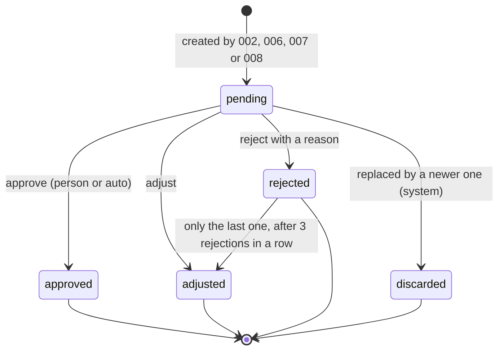

# Implementation Plan: 005 · Proposals, approval and live activity

**Date**: 2026-10-23  
**Spec**: [spec.md](spec.md)  
**Status**: Approved

## Summary

The shared lifecycle of every proposal, and the project's activity feed (UC-04, UC-14). Backend only. It builds on what spec 002 already sets up (`Proposal` persistence, `spawn()` and the per-task `uow_factory`) and on the fields spec 008 adds (`origin`, `discarded`):

- **Decide**: `ApproveProposal`, `AdjustProposal` and `RejectProposal` save the decision in the request's transaction and publish `ProposalResolved`. Adjustments are validated against the kind's schema.
- **Apply**: right after, the router `spawn`s `ApplyProposal(proposal_id)`. It looks up the step the owner spec registered for that kind (`AdvancePlanning.on_proposal_resolved`, `ApplyDocumentProposal`, `PublishIssues` / `ApplyReview`, `ApplyReplan`) and calls it. If it fails, the proposal is flagged `apply_failed`, `ProposalApplyFailed` is published, and the leader can retry.
- **Auto-approve**: the rule lives in the domain (`should_auto_approve`), and `AutoApprove.after_created(proposal_id)` is the helper creators call after saving a proposal.
- **Activity**: a `PersistentEventBus` saves every event in an `activity` table before fanning it out. That gives order numbers, the history endpoint and SSE replay with `Last-Event-ID`.

## Technical Context

**Language/Version**: Python 3.13  
**Primary Dependencies**: FastAPI, `sse-starlette` (already in `requirements.txt`), Pydantic, SQLModel  
**Storage**: SQLite. Uses spec 002's `proposal` table (+ `apply_failed`, `apply_error`); new `activity` table  
**Testing**: pytest. Domain and use cases with `backend/tests/fakes.py` (spec 001, T009); integration with TestClient on in-memory SQLite  
**Target Platform**: Linux server, single process (in-memory bus); Cloud Run as the deployment target  
**Project Type**: web (backend + frontend); this plan only touches `backend/`  
**Performance Goals**: deciding answers in < 1 s (SC-001); a notice arrives in < 2 s (SC-002)  
**Constraints**: hexagonal dependency rule (`tests/architecture/test_layers.py`); anything slow runs outside the request with its own DB session; works without a Gemini key or GitHub token (FR-017)  
**Scale/Scope**: tens of proposals and hundreds of notices per project; replay of up to 200 notices on reconnect

## Project Structure

### Documentation (this feature)

```text
specs/005-proposals-approval/
├── plan.md              # This file
└── spec.md              # Feature spec
```

### Source Code (repository root)

```text
backend/app/
├── domain/
│   ├── proposals.py                     # + discard(), apply_failed, consecutive_rejections(),
│   │                                    #   adjust_after_limit(), should_auto_approve()
│   ├── proposal_schemas.py              # NEW: content_schema(kind, key)
│   ├── events.py                        # + common fields, ProposalResolved fields, ProposalApplyFailed
│   └── errors.py                        # + NoApplierForProposal, ProposalNotRetryable
├── application/
│   ├── ports/
│   │   ├── repositories.py              # + ProposalRepository.save_if_status, ActivityRepository
│   │   └── unit_of_work.py              # + activity
│   ├── dto.py                           # + ProposalAdjust, ProposalReject, BulkApprove, BulkResult
│   └── use_cases/
│       ├── proposals/
│       │   ├── list_proposals.py        # ListProposals, GetProposal
│       │   ├── resolve_proposal.py      # ApproveProposal, AdjustProposal, RejectProposal
│       │   ├── apply_proposal.py        # ApplyProposal + ProposalAppliers (registry type)
│       │   ├── auto_approve.py          # AutoApprove.after_created (used by 002, 006, 007, 008)
│       │   └── approve_many.py          # ApproveProposals
│       └── activity/
│           └── list_activity.py         # ListActivity
└── adapters/
    ├── inbound/http/
    │   ├── proposals.py                 # /api/proposals/..., /api/projects/{id}/proposals
    │   ├── activity.py                  # /api/projects/{id}/activity, /api/projects/{id}/events (SSE)
    │   ├── dependencies.py              # + appliers registry, use case providers
    │   └── errors.py                    # + 409 / 501 mapping
    └── outbound/
        ├── persistence/tables.py, mappers.py, repositories.py, unit_of_work.py   # + ActivityTable
        └── events/persistent_bus.py     # NEW: PersistentEventBus

backend/tests/
├── unit/domain/test_proposals.py, test_proposal_schemas.py
├── unit/application/test_resolve_proposal.py, test_apply_proposal.py, test_auto_approve.py
└── integration/adapters/test_proposals_api.py, test_activity_api.py, test_persistent_bus.py
```

**Structure Decision**: the existing hexagonal layout. The SSE endpoint lives in `activity.py` because it streams the whole project's activity, not only planning; spec 002's plan allows it ("If 005 lands first with the endpoint, skip T009"). No frontend files.

## Design

### Lifecycle



Applying is separate from the status: an `approved` or `adjusted` proposal may carry `apply_failed = True` until a retry succeeds.

### Domain (`domain/proposals.py`)

Fields that other plans add, and that this plan adds if it lands first: `rejection_reason` + `reject(reason)` (002, T003), and `origin: Literal["leader", "automatic"]` + status `discarded` (008, T002). This plan adds:

- `reject(reason)` trims the reason and raises `ValidationFailed("reason", ...)` (spec 001, T006) when it's empty (FR-007).
- `discard()`: only from `pending` (FR-010).
- `apply_failed: bool = False`, `apply_error: str | None`, `mark_applied()` and `mark_apply_failed(error)`.
- `consecutive_rejections(history) -> int`: walks the proposals of a subject (`kind`, `key`) from newest to oldest, counting `rejected` until an `approved` or `adjusted` one; `discarded` ones neither count nor stop it. `MAX_CONSECUTIVE_REJECTIONS = 3`. **Shared with spec 002**: `AdvancePlanning` (002, T032) uses it instead of counting on its own, so both specs agree on when a stage is capped.
- `adjust_after_limit(content, history)`: `rejected → adjusted`, only if it's the newest proposal of its subject and `consecutive_rejections(history) >= 3`.
- `should_auto_approve(project) -> bool`: `project.auto_approve and self.origin != "automatic"` (FR-011).

`proposal_schemas.py`: `content_schema(kind, key) -> type[BaseModel]`. `plan_stage` resolves through `stage_by_key` (002, T007); specs 006, 007 and 008 add their entries (`GeneralSpec`/`EpicSpec`/`FlowDiagrams`, the GitHub action payloads, `Replan`). An unknown subject raises `ValidationFailed`: there's no free-form content (constitution, principle 2).

### Events (`domain/events.py`)

`DomainEvent` gets common fields, all with defaults so existing events keep working: `seq: int | None` (set by the bus), `occurred_at`, `actor: Literal["agent", "person", "github", "system"] = "system"`, `summary: str = ""`, `ref: EventRef | None` (`kind` + `id`). `ProposalCreated` gets `kind`, `key` and `agent`; `ProposalResolved` gets `kind`, `key`, `auto` and `reason`. New: `ProposalApplyFailed(proposal_id, error)`.

### Ports

- `ProposalRepository.save_if_status(proposal, expected: ProposalStatus)`: `UPDATE ... WHERE id = :id AND status = :expected`; raises `ProposalAlreadyResolved` when no row matches. Covers two decisions at the same time without locks. Added to spec 002's `SqlProposalRepository`.
- `ActivityRepository` (read-only for use cases): `list_recent(project_id, before_seq, limit)` and `list_after(project_id, after_seq, limit)`. `activity` goes on the `UnitOfWork`.

### Deciding (`resolve_proposal.py`)

Approve, adjust and reject share one flow in the request's `UnitOfWork`:

1. `uow.proposals.get(id)`, or `NotFound`.
2. Apply the domain transition. Before adjusting, validate the content with `content_schema` (FR-005). Adjusting a rejected proposal goes through `adjust_after_limit` with `uow.proposals.list_by_project` filtered by subject.
3. `save_if_status(proposal, previous_status)` and `commit()`.
4. `publish(ProposalResolved)` and return the proposal.

The router then calls `spawn(apply_proposal(proposal.id))` and answers `200`. Deciding never waits for an agent (SC-001).

### Applying (`apply_proposal.py`)

```python
Applier = Callable[[int], Awaitable[None]]       # takes the proposal id, opens its own UoW

class ProposalAppliers(Protocol):
    def for_proposal(self, proposal: Proposal) -> Applier | None: ...
```

`ApplyProposal(proposal_id)` opens its own `UnitOfWork` from `uow_factory`, loads the proposal, gets its applier and awaits it. On success it calls `mark_applied()`. On an exception it calls `mark_apply_failed(str(error))`, commits and publishes `ProposalApplyFailed`. Retrying (`POST /api/proposals/{id}/apply`) runs the same use case and is only allowed for `approved`/`adjusted` proposals with `apply_failed` (`ProposalNotRetryable` otherwise).

The registry is built in `dependencies.py`, the only place that knows every spec's use cases:

| Kind and status | Applier | Owner |
|---|---|---|
| `plan_stage`, any resolution (approved, adjusted or rejected) | `AdvancePlanning.on_proposal_resolved(proposal_id)` | 002 |
| `document`, approved or adjusted | `ApplyDocumentProposal(proposal_id)` | 006 |
| `document`, rejected | 006's redo step (to agree; 006 says it follows 002's redo rule) | 006 |
| `github_action` `create_issues`, approved or adjusted | `PublishIssues(proposal_id)` | 007 |
| `github_action` `request_review`, approved or adjusted | `ApplyReview(proposal_id)` | 007 |
| `replan`, approved or adjusted | `ApplyReplan(proposal_id)` | 008 |
| `github_action` or `replan`, rejected | none | — |

A kind without a registered applier is still decided, and applying fails with `NoApplierForProposal` (shown as `ProposalApplyFailed`). This plan can therefore be tested before the other specs land.

### Auto-approve (`auto_approve.py`)

`AutoApprove.after_created(proposal_id)` is what a creator calls right after saving a proposal: if `proposal.should_auto_approve(project)`, it calls `approve(auto=True)`, `save_if_status` and commit, publishes `ProposalResolved(auto=True)` and awaits `ApplyProposal`. Spec 002's `RunPlanningStep` (002, T015) does this inline today; the contract is that it calls this helper instead, so the `origin` exception applies everywhere. The project's flag is read when the proposal is created, so turning it on doesn't touch pending ones (FR-012).

### Activity and SSE

- `PersistentEventBus(inner: InMemoryEventBus, session_factory)`: `publish` inserts an `ActivityTable` row in its own session, uses its autoincrement `id` as `seq` (global and increasing, so it also orders events within a project), then hands the event to the in-memory bus. Events are saved even with nobody connected. `main.py` uses it instead of `InMemoryEventBus`.
- `GET /api/projects/{id}/events` (`EventSourceResponse`):
  1. Subscribe first and buffer what arrives meanwhile.
  2. If there's a `Last-Event-ID` header (or `?after=`), send `list_after(project_id, after, 201)`. If there are more than 200, send a single `resync` event instead (FR-015).
  3. Continue live, dropping anything with `seq <=` the last one sent.
  - Each SSE message carries `id: seq`, `event: type`, `data: json`. The replay logic is a pure async generator, tested on its own.
- `GET /api/projects/{id}/activity?before=&limit=50` → `ListActivity`, newest first (FR-016).

### API

| Method and path | Body | Response | Story |
|---|---|---|---|
| `GET /api/projects/{id}/proposals?status=` | — | `200` + list | US1 |
| `GET /api/proposals/{id}` | — | `200` · `404` | US1 |
| `POST /api/proposals/{id}/approve` | — | `200` + `Proposal` · `404` · `409` | US2 |
| `POST /api/proposals/{id}/adjust` | `{content}` | `200` · `409` · `422` | US2, US4 |
| `POST /api/proposals/{id}/apply` | — | `202` · `409` | US2 (retry) |
| `POST /api/proposals/{id}/reject` | `{reason}` | `200` · `409` · `422` | US4 |
| `POST /api/projects/{id}/proposals/approve` | `{ids: [...]}` | `200` + `[{id, ok, error}]` | US7 |
| `GET /api/projects/{id}/activity?before=&limit=` | — | `200` + list | US6 |
| `GET /api/projects/{id}/events` | `Last-Event-ID` header | `text/event-stream` | US3 |

Errors: `ProposalAlreadyResolved` → `409` (already mapped), `ValidationFailed` → `422` (spec 001), `ProposalNotRetryable` → `409`.

## Decisions and alternatives

| Decision | Discarded alternative | Why |
|---|---|---|
| Decide in the request, apply in a spawned task | Approve and apply in one transaction | Owner specs' steps (`AdvancePlanning`, `ApplyReplan`…) take a proposal id and open their own UoW, and some call agents or GitHub |
| A registry of appliers built in `dependencies.py` | `if kind == ...` inside the use case | Each spec plugs its step in without touching 005; it's the call list the other plans already expect |
| `apply_failed` flag + retry endpoint | Roll the decision back when applying fails | The decision is the leader's and stays; only the application is retried |
| `should_auto_approve` in the domain + `AutoApprove` helper | Each creator checks `project.auto_approve` | One rule, including the "raised by the system" exception (008, FR-016) |
| `consecutive_rejections` in the domain, shared with 002 | 002 and 005 counting separately | Both must agree on when a stage is capped |
| The bus persists events | Each use case writes the activity | No spec can forget to log, and the order number comes for free |
| `seq` = global autoincrement id | Per-project counter | No locks or races; it only needs to increase |
| `save_if_status` | Row locks or an in-memory lock | Works on SQLite and across sessions |
| SSE in `activity.py` | `planning.py` (002, T009) | The feed is for the whole project |

## Risks

- **Ordering with 002 and 008**: the `proposal` table, `spawn` and `uow_factory` come from 002, and `origin`/`discarded` from 008. If 005 lands first, it adds them (same fields and names) and the other plans skip those tasks. Agree on it in the review.
- **Lost tasks on restart**: `spawn` doesn't survive a server restart. An approved proposal that was never applied stays without `apply_failed`; for the demo that's acceptable, and the retry endpoint covers it once the flag is set.
- **Single process**: the in-memory bus doesn't fan out across Cloud Run instances; the `EventBus` port allows replacing it later.
- **SSE tests**: TestClient with endless streams is brittle; the replay generator is tested on its own and HTTP only checks a short replay.
- **Document rejections**: the step spec 006 runs on a rejected document isn't named in its plan yet.

---

## API Contract

Follows [plan/api-conventions.md](../../plan/api-conventions.md) (headers, error body, status codes) and details the [API](#api) table above. The API tests assert every status row below.

New domain errors: `ProposalNotRetryable` (409 `proposal_not_retryable`); `ProposalAlreadyResolved` (409 `proposal_already_resolved`) already exists; `ProposalNotFound` (404 `proposal_not_found`).

### Shared shapes

**Proposal** (spec 002's shape plus what this spec and 008 add)

```json
{
  "id": 41,
  "project_id": 12,
  "kind": "plan_stage",
  "key": "methodology",
  "agent": "Agile coach",
  "content": { /* schema of the subject */ },
  "rationale": "…",
  "status": "pending",
  "adjusted_content": null,
  "rejection_reason": null,
  "auto_approved": false,
  "origin": "leader",
  "apply_failed": false,
  "apply_error": null,
  "created_at": "2026-10-23T14:06:10Z",
  "resolved_at": null
}
```

`status`: `pending` | `approved` | `adjusted` | `rejected` | `discarded`. `origin`: `leader` | `automatic`. `apply_failed` + `apply_error` describe a failed application of an approved/adjusted proposal (it can be retried).

**ActivityEvent**: any domain event with the common fields this spec adds.

```json
{
  "seq": 1532,
  "type": "proposal_resolved",
  "project_id": 12,
  "occurred_at": "2026-10-23T14:07:00Z",
  "actor": "person",
  "summary": "Ana approved the methodology",
  "ref": { "kind": "proposal", "id": 41 },
  "proposal_id": 41, "kind": "plan_stage", "key": "methodology", "status": "approved", "auto": false, "reason": null
}
```

`actor`: `agent` | `person` | `github` | `system`. Fields after `ref` depend on `type`.

### `GET /api/projects/{id}/proposals` — list proposals (US1)

Query: `status` (optional, one value; `pending` to show the inbox). Newest first.

| Status | When | Body |
|---|---|---|
| `200` | Always (empty list if none) | `Proposal[]` |
| `404` | Unknown project | Error `project_not_found` |
| `422` | `status` isn't a valid status | Error `validation_failed` with `errors` (`field: "status"`) |

### `GET /api/proposals/{id}` — read a proposal (US1)

| Status | When | Body |
|---|---|---|
| `200` | Exists | `Proposal` |
| `404` | Unknown proposal | Error `proposal_not_found` |

### `POST /api/proposals/{id}/approve` — approve (US2)

No body. The decision is saved in the request; applying it (next stage, board, issues…) runs in the background and reports through events.

| Status | When | Body |
|---|---|---|
| `200` | Approved | `Proposal` (`status: "approved"`) |
| `404` | Unknown proposal | Error `proposal_not_found` |
| `409` | Not `pending` (already decided, by someone else or by auto-approve) | Error `proposal_already_resolved`, plus `"status": "approved"` |

### `POST /api/proposals/{id}/adjust` — approve with changes (US2, US4)

Request headers: `Content-Type: application/json`

```json
{ "content": { /* the whole edited content, same schema as the proposal's content */ } }
```

Also allowed on the newest **rejected** proposal of a subject after 3 consecutive rejections (US4).

| Status | When | Body |
|---|---|---|
| `200` | Saved as `adjusted` | `Proposal` |
| `400` | Body isn't JSON | Error `malformed_request` |
| `404` | Unknown proposal | Error `proposal_not_found` |
| `409` | Not `pending`, and not the capped rejected case | Error `proposal_already_resolved` |
| `422` | `content` missing or doesn't match the subject's schema; nothing is saved | Error `validation_failed`, `errors[].field` prefixed with `content.` (e.g. `content.sprint_length_weeks`) |

### `POST /api/proposals/{id}/reject` — reject with a reason (US4)

Request headers: `Content-Type: application/json`

```json
{ "reason": "Two-week sprints are too long for this team." }
```

| Status | When | Body |
|---|---|---|
| `200` | Rejected; the owner spec decides what happens next (e.g. 002 redoes the stage) | `Proposal` (`status: "rejected"`) |
| `400` | Body isn't JSON | Error `malformed_request` |
| `404` | Unknown proposal | Error `proposal_not_found` |
| `409` | Not `pending` | Error `proposal_already_resolved` |
| `422` | `reason` missing, empty after trimming or > 1000 chars (FR-007) | Error `validation_failed` with `errors` |

### `POST /api/proposals/{id}/apply` — retry a failed application (US2)

No body.

| Status | When | Body |
|---|---|---|
| `202` | Applying again in the background | `{"proposal_id": 41, "status": "applying"}` |
| `404` | Unknown proposal | Error `proposal_not_found` |
| `409` | Not `approved`/`adjusted`, or `apply_failed` is `false` | Error `proposal_not_retryable` |

### `POST /api/projects/{id}/proposals/approve` — approve several (US7)

Request headers: `Content-Type: application/json`

```json
{ "ids": [52, 53, 54] }
```

Each id is decided on its own; one failing doesn't stop the others.

| Status | When | Body |
|---|---|---|
| `200` | Processed (even if some failed) | `[{"id": 52, "ok": true, "error": null}, {"id": 53, "ok": false, "error": {"code": "proposal_already_resolved", "detail": "…"}}]` |
| `400` | Body isn't JSON | Error `malformed_request` |
| `404` | Unknown project | Error `project_not_found` |
| `422` | `ids` missing, empty, more than 100, or not integers | Error `validation_failed` with `errors` |

An id from another project comes back as `{"ok": false, "error": {"code": "proposal_not_found"}}`.

### `GET /api/projects/{id}/activity` — activity history (US6)

Query: `before` (optional `seq`, exclusive), `limit` (1–200, default 50). Newest first; to load older items, pass the last item's `seq` as `before`.

| Status | When | Body |
|---|---|---|
| `200` | Always (empty list at the end) | `ActivityEvent[]` |
| `404` | Unknown project | Error `project_not_found` |
| `422` | `before` or `limit` invalid | Error `validation_failed` with `errors` |

### `GET /api/projects/{id}/events` — live events with replay (US3)

This spec owns the SSE endpoint (spec 002, T009 is skipped or moved here).

Request headers: `Accept: text/event-stream`; `Last-Event-ID: <seq>` (set by `EventSource` on reconnect). `?after=<seq>` does the same for the first connection.

| Status | When | Body |
|---|---|---|
| `200` | Stream opened | `text/event-stream` |
| `404` | Unknown project (before the stream starts) | Error `project_not_found` (JSON) |
| `422` | `Last-Event-ID` / `after` isn't an integer | Error `validation_failed` |

Stream:

1. If `Last-Event-ID`/`after` is given, the events after it are sent first, in order. If there are more than 200, a single `resync` event is sent instead and the client refetches everything (FR-015).
2. Then live events, without duplicates.
3. Every message carries `id: <seq>`, `event: <type>`, `data: <ActivityEvent json>`. `: ping` every 15 s.

```text
id: 1532
event: proposal_resolved
data: {"seq":1532,"type":"proposal_resolved","project_id":12,…}

event: resync
data: {"type":"resync","project_id":12}
```

---

## Phase 1: Setup (Shared Infrastructure)

**Purpose**: reuse what spec 002 sets up

- [ ] T001 Check that `spawn()` (`backend/app/adapters/inbound/http/background.py`) and `get_uow_factory()` exist (spec 002, T001–T002); if not, create them as 002's plan describes
- [ ] T002 Check that `backend/tests/fakes.py` exists (spec 001, T009) and add `activity` to `InMemoryUnitOfWork`

---

## Phase 2: Foundational (Blocking Prerequisites)

**Purpose**: proposal fields and rules, schemas, persistence and the common event fields

**⚠️ CRITICAL**: no user story work can begin until this phase is complete

- [ ] T003 Make sure `Proposal` has `rejection_reason`/`reject(reason)` (002, T003) and `origin`/`discarded` (008, T002); add whatever is missing, plus `discard()`, `apply_failed`, `apply_error`, `mark_applied()` and `mark_apply_failed()` in `backend/app/domain/proposals.py`
- [ ] T004 [P] Create `backend/app/domain/proposal_schemas.py` with `content_schema` for `plan_stage`; tests in `backend/tests/unit/domain/test_proposal_schemas.py`
- [ ] T005 [P] Add the common fields to `DomainEvent`, the new `ProposalCreated`/`ProposalResolved` fields and `ProposalApplyFailed` in `backend/app/domain/events.py`; add `NoApplierForProposal` and `ProposalNotRetryable` in `errors.py` and map them in `adapters/inbound/http/errors.py`
- [ ] T006 Make sure `ProposalTable` exists (002, T004); add `apply_failed`, `apply_error`, `origin` and `rejection_reason` columns if missing, and `save_if_status` to the port and `SqlProposalRepository`
- [ ] T007 [P] Persistence tests: proposal round trip with all fields, `save_if_status` failing when the status changed, in `backend/tests/integration/adapters/test_persistence.py`

**Checkpoint**: proposals persist with every field this spec needs

---

## Phase 3: User Story 1 - See what the agents proposed and why (Priority: P1) 🎯 MVP

**Goal**: list and read proposals

**Independent Test**: three proposals in different statuses; `?status=pending` returns one and the full list returns three in order

### Tests for User Story 1

- [ ] T008 [P] [US1] API tests for both GETs (all, filtered, one, 404) in `backend/tests/integration/adapters/test_proposals_api.py`

### Implementation for User Story 1

- [ ] T009 [US1] Implement `ListProposals` and `GetProposal` in `backend/app/application/use_cases/proposals/list_proposals.py`
- [ ] T010 [US1] Create `backend/app/adapters/inbound/http/proposals.py` with both GETs; add providers to `dependencies.py` and include the router in `backend/app/main.py`

**Checkpoint**: proposals can be read with agent, content and rationale

---

## Phase 4: User Story 2 - Approve or adjust a proposal (Priority: P1)

**Goal**: approve and adjust save the decision and hand the proposal to its owner's applier

**Independent Test**: approving the analysis proposal answers 200 and `AdvancePlanning.on_proposal_resolved` is called with its id; adjusting validates the content; a failing applier leaves `apply_failed` and retry works

### Tests for User Story 2

- [ ] T011 [P] [US2] `ApproveProposal`/`AdjustProposal` tests (approve, valid adjust, invalid adjust keeps it pending, already resolved, `ProposalResolved` published after commit) in `backend/tests/unit/application/test_resolve_proposal.py`
- [ ] T012 [P] [US2] `ApplyProposal` tests with fake appliers (right applier per kind and key, success marks applied, exception marks `apply_failed` and publishes `ProposalApplyFailed`, missing applier, retry only when failed) in `backend/tests/unit/application/test_apply_proposal.py`
- [ ] T013 [P] [US2] API tests for approve, adjust and apply (200, 202, 409, 422) in `backend/tests/integration/adapters/test_proposals_api.py`

### Implementation for User Story 2

- [ ] T014 [US2] Implement the shared flow plus `ApproveProposal` and `AdjustProposal` in `backend/app/application/use_cases/proposals/resolve_proposal.py`
- [ ] T015 [US2] Implement `ApplyProposal` and the `ProposalAppliers` protocol in `backend/app/application/use_cases/proposals/apply_proposal.py`
- [ ] T016 [US2] Build the appliers registry in `backend/app/adapters/inbound/http/dependencies.py` with the entries that exist so far (`AdvancePlanning` from 002); the rest are added by their owner specs
- [ ] T017 [US2] Add `POST /approve`, `/adjust` and `/apply` to `proposals.py`; `approve` and `adjust` `spawn` `ApplyProposal` after answering

**Checkpoint**: approving stage by stage moves the plan forward (with spec 002's `AdvancePlanning`)

---

## Phase 5: User Story 3 - Follow the activity live (Priority: P1)

**Goal**: SSE per project, with order numbers and replay on reconnect

**Independent Test**: connect, create and approve a proposal; two notices arrive in order and none from another project

### Tests for User Story 3

- [ ] T018 [P] [US3] `PersistentEventBus` tests (every event saved, increasing `seq`, only the right project's subscribers get it) in `backend/tests/integration/adapters/test_persistent_bus.py`
- [ ] T019 [P] [US3] Replay generator tests (no `Last-Event-ID`, missed notices, more than 200 → `resync`, no duplicates between replay and live)
- [ ] T020 [P] [US3] Short SSE API test (replays what was missed, then closes) in `backend/tests/integration/adapters/test_activity_api.py`

### Implementation for User Story 3

- [ ] T021 [US3] Add `ActivityTable`, its mapper and `SqlActivityRepository` in `backend/app/adapters/outbound/persistence/`, and `ActivityRepository` + `activity` on the `UnitOfWork` port
- [ ] T022 [US3] Implement `PersistentEventBus` in `backend/app/adapters/outbound/events/persistent_bus.py` and use it in `backend/app/main.py`
- [ ] T023 [US3] Create `backend/app/adapters/inbound/http/activity.py` with `GET /api/projects/{id}/events` and the replay generator; if spec 002's T009 already created the endpoint in `planning.py`, move it here

**Checkpoint**: P1 done; the manual-approval demo can be followed live

---

## Phase 6: User Story 4 - Reject with a reason (Priority: P2)

**Goal**: reject with a reason, hand it to the owner, and let the leader write their own version once a stage is capped

**Independent Test**: rejecting the roadmap saves the reason and calls `AdvancePlanning`; after 3 rejections in a row, the last rejected one can be adjusted and approved; before that, it can't

### Tests for User Story 4

- [ ] T024 [P] [US4] Domain tests for `consecutive_rejections` (resets on approval, `discarded` neither counts nor stops it) and `adjust_after_limit` in `backend/tests/unit/domain/test_proposals.py`
- [ ] T025 [P] [US4] `RejectProposal` tests (empty reason → 422, reason saved, applier called for `plan_stage`, nothing for `replan`) and adjusting a capped rejected proposal, in `backend/tests/unit/application/test_resolve_proposal.py`

### Implementation for User Story 4

- [ ] T026 [US4] Add `consecutive_rejections`, `MAX_CONSECUTIVE_REJECTIONS` and `adjust_after_limit` to `backend/app/domain/proposals.py`; tell Mitchz01 so `AdvancePlanning` (002, T032) uses them
- [ ] T027 [US4] Implement `RejectProposal` in `resolve_proposal.py`, allow the capped case in `AdjustProposal`, and add `POST /api/proposals/{id}/reject` to `proposals.py`

---

## Phase 7: User Story 5 - Auto-approve (Priority: P2)

**Goal**: one auto-approve rule for every creator

**Independent Test**: with auto-approve on, `after_created` approves a stage proposal with `auto_approved = true` and applies it; one with `origin = "automatic"` stays pending

### Tests for User Story 5

- [ ] T028 [P] [US5] Tests for `should_auto_approve` and `AutoApprove.after_created` (approves and applies; respects `origin = "automatic"`; does nothing when the flag is off) in `backend/tests/unit/application/test_auto_approve.py`

### Implementation for User Story 5

- [ ] T029 [US5] Add `should_auto_approve` to `backend/app/domain/proposals.py` and implement `AutoApprove` in `backend/app/application/use_cases/proposals/auto_approve.py`; agree with Mitchz01 that `RunPlanningStep` (002, T015) calls it

**Checkpoint**: with auto-approve and mock agents, the six stages reach `PlanCompleted` with no action (SC-006, once 002 and 003 land)

---

## Phase 8: User Story 6 - Activity history (Priority: P2)

**Goal**: earlier notices, 50 at a time

**Independent Test**: five notices with nobody connected; the history returns them newest first, and two at a time with `limit`

### Tests for User Story 6

- [ ] T030 [P] [US6] API tests for the history (order, `limit`, `before`) in `backend/tests/integration/adapters/test_activity_api.py`

### Implementation for User Story 6

- [ ] T031 [US6] Implement `ListActivity` in `backend/app/application/use_cases/activity/list_activity.py` and `GET /api/projects/{id}/activity` in `activity.py`

---

## Phase 9: User Story 7 - Approve several at once (Priority: P3)

**Goal**: bulk approval, each proposal on its own

**Independent Test**: three pending and one resolved; the answer has three `ok` and one error

### Tests for User Story 7

- [ ] T032 [P] [US7] `ApproveProposals` tests (result per id, one already resolved, one from another project)

### Implementation for User Story 7

- [ ] T033 [US7] Implement `ApproveProposals` in `backend/app/application/use_cases/proposals/approve_many.py` (one transaction and one `ApplyProposal` spawn per proposal) and `POST /api/projects/{id}/proposals/approve`

---

## Phase 10: Polish & Cross-Cutting Concerns

- [ ] T034 Run the full `pytest`, including `test_layers.py`
- [ ] T035 [P] Update the proposal state diagram and UC-04/UC-14 in [plan/use-cases.md](../../plan/use-cases.md): `discarded`, decide-then-apply with retry, SSE in `activity.py`, `200` on approve
- [ ] T036 Check the scenarios by hand with `fastapi dev`, `curl -N` on `/events` and mock mode

---

## Dependencies & Execution Order

### Phase Dependencies

- **Setup** and **Foundational** block everything. They depend on spec 001 (T006 `ValidationFailed`, T009 `fakes.py`) and reuse spec 002's T001–T004 and spec 008's T002, or add those pieces if 005 lands first.
- **Polish** after the desired stories.

### User Story Dependencies

- **US1 (P1)**: after Foundational
- **US2 (P1)**: after Foundational; its API tests reuse US1's router
- **US3 (P1)**: after Foundational; independent from US1 and US2 (any event will do)
- **US4 (P2)**: needs US2's shared flow
- **US5 (P2)**: needs US2's `ApplyProposal`
- **US6 (P2)**: needs US3's `activity` table
- **US7 (P3)**: needs US2

### Cross-spec dependencies

- **002 → 005** (Mitchz01): `AdvancePlanning.on_proposal_resolved(proposal_id)` is registered for every `plan_stage` resolution; `RunPlanningStep` calls `AutoApprove.after_created`; `AdvancePlanning` uses `consecutive_rejections`. 002 provides `spawn`, `uow_factory` and the `proposal` table.
- **005 → 003** (codigotpx): no direct call; 003's `ApplyPlan` runs on 002's `PlanCompleted`. Board events (`PlanApplied`, `TaskStatusChanged`, `TaskUpdated`) are shown as they are.
- **005 → 006** (Mitchz01): `ApplyDocumentProposal(proposal_id)` for approved/adjusted documents; the rejected-document step is still to be named.
- **005 → 007** (codigotpx): `PublishIssues(proposal_id)` and `ApplyReview(proposal_id)` by key.
- **005 → 008** (Mitchz01): `ApplyReplan(proposal_id)`; 008 sets `origin = "automatic"` on drift replans and calls `discard()` on the replaced one.
- **006, 007, 008**: each adds its entry to `proposal_schemas.py`.

### Within Each User Story

- Domain rules before use cases
- Use cases before endpoints
- Tests marked `[P]` can be written in parallel

## Notes

- [Story] labels map tasks to user stories for traceability
- Each user story is independently completable and testable
- Commit after each task or logical group, and check the box here
- Out of scope: frontend screens (including the proposal card and the replan diff UI that specs 006 and 008 mention)
